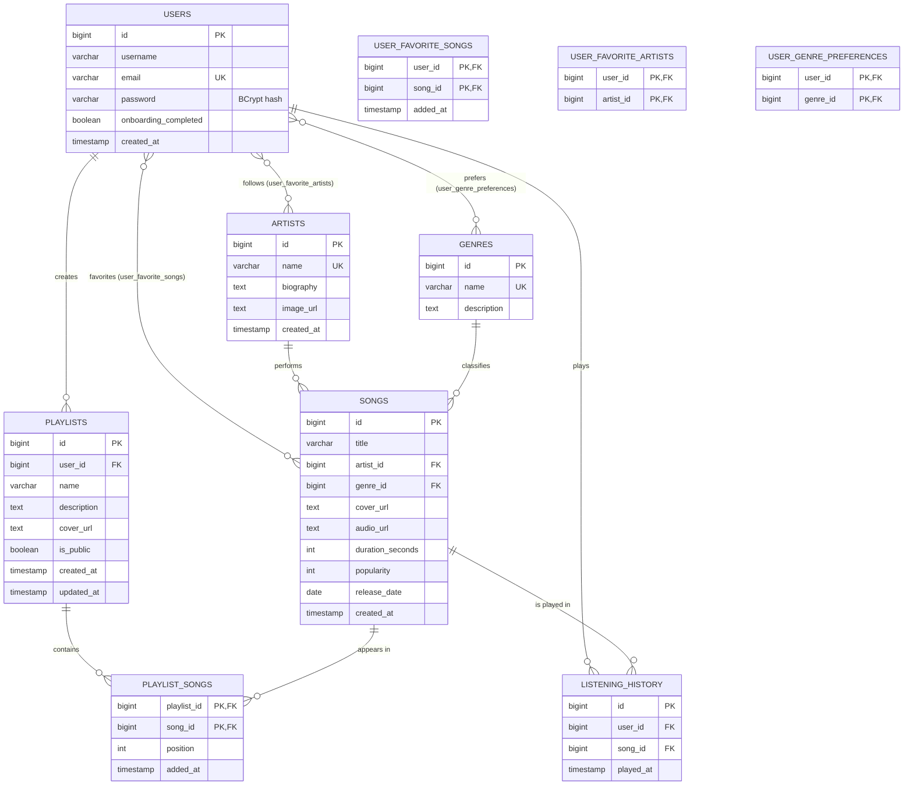

# MuseStream – Entity Relationship Diagram

The diagram below renders automatically on GitHub, VS Code (Markdown Preview Mermaid Support) and most Markdown viewers.



## What changed compared with the original schema

| Change | Why |
|---|---|
| New table `listening_history` | Records every play. Feeds the recommendation engine and the dashboard. |
| `playlists`: `description`, `cover_url`, `is_public`, `updated_at`; `user_id` is now `NOT NULL` | Richer playlists; a playlist must always belong to a user. |
| `playlist_songs`: `position`, `added_at` | Keeps the song order inside a playlist. |
| `artists`: `biography`, `UNIQUE(name)` | Artist page; prevents duplicate artists. |
| `songs`: `release_date`, `created_at`, `UNIQUE(title, artist_id)`, `CHECK` constraints | "New releases"; makes seeding idempotent; blocks negative values. |
| Indexes on every foreign key, `popularity`, `LOWER(title)`, `LOWER(name)`, `(user_id, played_at DESC)` | Fast joins, search, trending and history queries. |
| `ON DELETE` rules | Deleting a user cascades to their data; deleting an artist/genre keeps the songs (`SET NULL`); deleting a song removes it from playlists, favorites and history (`CASCADE`). |
| Scripts are idempotent (`IF NOT EXISTS`, `ON CONFLICT DO NOTHING`) | The backend can restart without wiping data. Use `database/reset.sql` for a clean slate. |

## Relationships used by the recommendation engine

```
User ──► user_genre_preferences ──► Genre   ──┐
User ──► user_favorite_artists  ──► Artist  ──┼──►  score every Song
User ──► user_favorite_songs    ──► Song    ──┤
User ──► listening_history      ──► Song    ──┘
```
